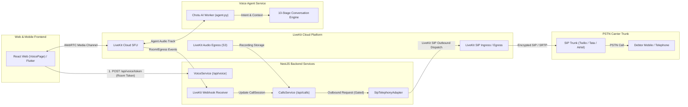
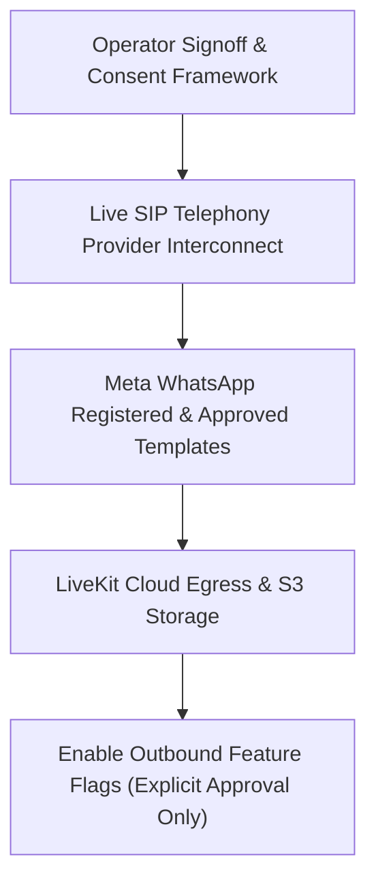

# myCashFlo — Live Operations & Razorpay Readiness Report

**Audit & Implementation Date:** 02 November 2026  
**Status:** Verification & Hardening Complete  
**Overall Readiness Verdict:** **READY FOR RAZORPAY SANDBOX / PRE-LIVE GATEWAY TESTING**  
*(Live Outbound Voice & Messaging Remain Strictly BLOCKED and Suppressed by Policy)*

---

## 1. Implementation & Configuration Status

### Implemented Capabilities
- **Strict Server-Side Razorpay Integration:** All Razorpay API communication occurs exclusively on the backend (`services/api/src/integrations/adapters/razorpay.adapter.ts`). No payment gateway secrets or direct API calls are accessible to or invoked by the browser client.
- **Zero Silent Fallback in Live Mode:** The previous behavior where missing credentials silently generated mock `https://rzp.io/i/mock_...` URLs has been completely eliminated. If live mode is selected (`PAYMENT_SIMULATION_MODE=false`) and credentials are unconfigured or invalid, the API immediately throws an explicit `BadRequestException`.
- **Gated Simulation Isolation:** Payment simulation is strictly prohibited in production (`process.env.NODE_ENV === 'production'`). In development and test environments, simulation links are generated **only** when explicitly requested (`simulate: true` in the request DTO or `PAYMENT_SIMULATION_MODE=true` in the environment).
- **HMAC-SHA256 Webhook Signature Verification:** Webhook payloads received from Razorpay are validated against the exact raw request body buffer using `crypto.timingSafeEqual`, preventing timing attacks, replay attacks, and payload tampering.
- **Financial Integrity Across Non-Payment Webhooks:** Webhook events with status `FAILED`, `CANCELLED`, or `EXPIRED` (`payment.failed`, `payment_link.cancelled`, `payment_link.expired`) record audit history and internal state without modifying invoice outstanding balances or customer account balances. Only verified `COMPLETED` events (`payment_link.paid` or `payment.captured`) trigger balance reductions.
- **Webhook Deduplication & Replay Idempotency:** Duplicate and replayed webhook events with identical provider payment identifiers (`providerPaymentId`) or reference IDs (`ref`) are handled idempotently inside a single atomic database transaction, preventing double-credits.
- **Super Admin Settings & Profile:** Reorganized `/platform/settings` with a dedicated **My Profile** card at the top supporting inline display name updates (`PATCH /api/auth/profile`), immediate UI state refresh (`AuthContext.updateUser`), role/account badges, and structured configuration cards matching the platform sky/blue theme.

### Required Configuration for Live Activation
To transition Razorpay from simulation to live operations, the operator must provide valid credentials in `services/api/.env`:
- `RAZORPAY_KEY_ID`: Live or Test API Key ID issued by Razorpay (`rzp_live_...` or `rzp_test_...`).
- `RAZORPAY_KEY_SECRET`: Corresponding API Secret issued by Razorpay.
- `RAZORPAY_WEBHOOK_SECRET`: Secret string configured in the Razorpay Webhooks dashboard.
- `PAYMENT_SIMULATION_MODE`: Set to `false` for real payment processing.

---

## 2. Razorpay Live Integration Status

### Client and Server Separation
The web frontend (`apps/web`) interacts with payment services exclusively through authenticated API endpoints:
- `POST /api/payments/payment-link`: Generates a hosted payment link.
- `GET /api/payments/invoices/:invoiceId`: Retrieves payment history and balance.
- `POST /api/payments/record`: Records offline/manual settlements (restricted to `ADMIN` and `MANAGER`).

At no point does the frontend import the Razorpay client SDK or hold gateway secrets.

### Payment Link Generation Workflow
1. **Authentication & Tenant Scoping:** Link creation requests require a valid JWT bearer token. The target invoice must exist within the authenticated user's `tenantId`.
2. **Invoice State Validation:** Invoices with status `PAID` or an outstanding balance of zero are rejected.
3. **Amount Calculation:** Invoice amounts in rupees are converted to paise (`Math.round(amount * 100)`) as mandated by the Razorpay API.
4. **Metadata Attachment:** The invoice number, customer name, email, and phone number are attached to the Razorpay `notes` payload for cross-referencing in webhook events.
5. **Safe Error Handling:** If credentials are missing or the Razorpay API returns an error, an explicit `BadRequestException` is returned. No fallback to mock links occurs.

---

## 3. Environment Variables & Placeholders

The placeholder file [`services/api/.env.example`](file:///d:/D_space/mycashflo/services/api/.env.example) has been updated with safe dummy values:

```bash
# ─── Payment Gateways (Razorpay & Stripe) ──────────────────────────────────
# Default mode requires valid credentials. Simulation mode allowed ONLY in development
# when PAYMENT_SIMULATION_MODE=true or requested per-call with simulate=true.
# Set PAYMENT_SIMULATION_MODE=false for production/live operations.
PAYMENT_SIMULATION_MODE=false

# Razorpay (Primary India Payment Gateway)
# Obtain from Razorpay Dashboard -> Settings -> API Keys & Webhooks
RAZORPAY_KEY_ID=rzp_test_placeholder_key_id
RAZORPAY_KEY_SECRET=placeholder_razorpay_key_secret
RAZORPAY_WEBHOOK_SECRET=placeholder_razorpay_webhook_secret

# Stripe (International Payment Gateway)
# Obtain from Stripe Dashboard -> Developers -> API keys & Webhooks
STRIPE_PUBLISHABLE_KEY=pk_test_placeholder_publishable_key
STRIPE_SECRET_KEY=sk_test_placeholder_secret_key
STRIPE_WEBHOOK_SECRET=whsec_placeholder_webhook_secret

# ─── Feature Flags ───────────────────────────────────────────────────────────
# Set to true ONLY after proper consent, compliance, and operator approval
ENABLE_OUTBOUND_CALLS=false
# Global feature flag for automated payment reminders through Chotu AI
AUTOMATED_REMINDERS_ENABLED=false
```

> [!IMPORTANT]
> Real API keys, tokens, and database passwords must never be committed to Git. The `.env` file in `services/api/` is excluded by `.gitignore`.

---

## 4. Razorpay Webhook Setup Guide

### Step-by-Step Dashboard Configuration
1. Log in to the [Razorpay Dashboard](https://dashboard.razorpay.com/) (select Test Mode first for initial verification).
2. Navigate to **Settings** $\to$ **Webhooks** $\to$ **Add New Webhook**.
3. **Webhook URL:** Enter your public API webhook endpoint:
   ```
   https://api.yourdomain.com/api/payments/webhook/razorpay
   ```
   *(For local testing, use a secure tunnel such as ngrok or localtunnel pointing to port 3000, e.g., `https://abc-123.ngrok-free.app/api/payments/webhook/razorpay`).*
4. **Secret:** Generate a cryptographically secure random string (at least 32 characters) and enter it into the Razorpay Secret field.
5. **Set Environment Variable:** Add the exact same secret to your server environment:
   ```env
   RAZORPAY_WEBHOOK_SECRET=your_secure_random_string_here
   ```
6. **Active Events:** Subscribe to the following events:
   - `payment_link.paid` (Primary link payment completion)
   - `payment.captured` (Direct payment capture)
   - `payment.failed` (Customer payment attempt failure)
   - `payment_link.cancelled` (Link explicitly cancelled)
   - `payment_link.expired` (Link reached expiration timestamp)
7. Save the webhook and confirm it is marked **Active**.

### Signature Verification Mechanics
When Razorpay sends an HTTP POST event, `RazorpayAdapter.verifyWebhook` performs verification:
```typescript
const hmac = crypto.createHmac('sha256', secret);
hmac.update(rawBody); // rawBody is Buffer of the exact request body
const digest = hmac.digest('hex');

const digestBuf = Buffer.from(digest, 'hex');
const sigBuf = Buffer.from(signature, 'hex');

if (digestBuf.length === sigBuf.length && crypto.timingSafeEqual(digestBuf, sigBuf)) {
  // Signature valid
}
```

### Event Handling & Financial Reconciliation Rules

| Webhook Event | Mapped Status | Financial Reconciliation Action | Audit Log Action |
| :--- | :--- | :--- | :--- |
| `payment_link.paid` | `COMPLETED` | **Deducts invoice outstanding balance** and customer account balance. Transitions invoice status to `PAID` or `PARTIALLY_PAID`. | `payment.created_via_webhook` |
| `payment.captured` | `COMPLETED` | **Deducts invoice outstanding balance** and customer account balance. Transitions invoice status to `PAID` or `PARTIALLY_PAID`. | `payment.created_via_webhook` |
| `payment.failed` | `FAILED` | **Zero financial modification.** Outstanding balances remain strictly unchanged. Payment attempt logged with status `FAILED`. | `payment.failed_via_webhook` |
| `payment_link.cancelled` | `CANCELLED` | **Zero financial modification.** Outstanding balances remain strictly unchanged. Pending link marked `CANCELLED`. | `payment.link_cancelled` |
| `payment_link.expired` | `EXPIRED` | **Zero financial modification.** Outstanding balances remain strictly unchanged. Pending link marked `EXPIRED`. | `payment.link_cancelled` |

---

## 5. Test Plan & Local Verification

The payment integration hardening is verified through automated Vitest test batteries:

### Executed Test Commands
```bash
# 1. Run Payment Webhook Hardening & Payments Service Regression Suites
npm --prefix services/api test -- payment-webhook-hardening.spec.ts payments.service.spec.ts

# 2. Run Integrations Service Unit Tests
npm --prefix services/api test -- integrations.service.spec.ts

# 3. Run Entire Backend Test Suite (All 31 Test Files)
npm --prefix services/api test
```

### Verified Scenarios
1. **Rejection of Missing Secrets in Production:** Verified that webhooks in `NODE_ENV=production` without a configured secret return `isValid: false` and are rejected with HTTP 400.
2. **Rejection of Simulation Signatures in Production:** Verified that signatures like `mock_valid_signature` are rejected in production mode even if a secret is configured.
3. **Rejection of Modified / Tampered Payloads:** Verified that tampering with the payload body while supplying a valid signature for the original body fails verification.
4. **Exact Raw-Body HMAC-SHA256 Verification:** Verified that signatures calculated over raw Buffer bytes pass verification and extract correct invoice numbers and amounts.
5. **Live Payment Link Credential Guard:** Verified that calling `createPaymentLink` without credentials throws `BadRequestException` and **never** returns a simulated link.
6. **Production Simulation Ban:** Verified that calling `createPaymentLink` with `simulate: true` in production throws `BadRequestException("Payment simulation mode is forbidden in production")`.
7. **Failed Event Safety:** Verified that `payment.failed` webhooks leave customer and invoice balances untouched and record a failed payment audit log.
8. **Cancelled / Expired Event Safety:** Verified that `payment_link.cancelled` and `payment_link.expired` webhooks leave customer and invoice balances untouched and return `{ status: 'CANCELLED' | 'EXPIRED' }`.
9. **Duplicate & Concurrent Delivery Idempotency:** Verified that duplicate webhook submissions do not deduct balances twice and resolve idempotently.

---

## 6. LiveKit Cloud Voice & SIP Telephony Integration

### Architecture Overview

myCashFlo implements a secure, modular voice calling architecture orchestrating LiveKit Cloud for real-time WebRTC audio sessions and an enterprise SIP trunk for carrier PSTN calling:



### Key Security & Operational Principles

1. **Short-Lived, Scoped Access Tokens:** All WebRTC access tokens are signed server-side using `livekit-server-sdk` with strict validity (`ttlSeconds` constrained between 60s and 3600s, default 900s). Tokens grant explicit permissions according to role:
   - `AGENT`: `canPublish: true`, `canSubscribe: true`, `canPublishData: true`
   - `CUSTOMER`: `canPublish: true`, `canSubscribe: true`, `canPublishData: false`
   - `OBSERVER`: `canPublish: false`, `canSubscribe: true`, `hidden: true`
2. **Strict Webhook Authentication:** The LiveKit webhook endpoint (`POST /api/voice/webhook/livekit`) requires a valid Authorization header signed with `LIVEKIT_WEBHOOK_SECRET` or `LIVEKIT_API_SECRET`. Simulation signatures (`mock_valid_signature`) are rejected with `UnauthorizedException` in production environments.
3. **Webhook Idempotency:** An in-memory LRU event registry tracks processed LiveKit event IDs (`eventId`), silently dropping replayed or duplicate webhook deliveries.
4. **Outbound Calling Policy Guard:** Outbound PSTN calling is strictly controlled by `ENABLE_OUTBOUND_CALLS=false`. If outbound calling is invoked while the flag is false, `SipTelephonyAdapter` immediately intercepts the request and returns a simulated session (`status: 'SIMULATED'`, `isSimulated: true`), logging:
   `"[SAFETY GUARD] Real outbound call suppressed. OUTBOUND_CALLS_ENABLED is false. Simulating SIP session."`
5. **Carrier Status Synchronization:** Inbound carrier callbacks (`POST /api/telephony/webhook/:provider`) update `CallSession` metadata (`carrierStatus`, `busyAt`, `failedAt`, `lastCallbackAt`), mapping carrier events (`busy`, `no-answer`, `failed`, `completed`) idempotently and updating timestamps.

---

## 7. Step-by-Step LiveKit Cloud & SIP Setup Guide

### Part A: LiveKit Cloud Setup

1. **Create Project:** Sign in to [LiveKit Cloud](https://cloud.livekit.io/) and create a project (e.g., `mycashflo-production`).
2. **Generate API Credentials:**
   - In **Settings $\to$ Keys**, generate an API Key and API Secret.
   - Note the project WebSocket URL (e.g., `wss://<your-project>.livekit.cloud`).
3. **Configure Webhook:**
   - In **Settings $\to$ Webhooks**, add your public endpoint:
     `https://api.yourdomain.com/api/voice/webhook/livekit`
   - Copy the generated Webhook Secret into `LIVEKIT_WEBHOOK_SECRET`.
   - Subscribe to events: `room_started`, `room_finished`, `participant_joined`, `participant_left`, `egress_started`, `egress_ended`.
4. **Configure Cloud Audio Egress (Recordings):**
   - In **Settings $\to$ Egress**, configure an S3-compatible bucket (e.g., AWS S3, Cloudflare R2, MinIO).
   - Enter `LIVEKIT_EGRESS_S3_BUCKET` and set `LIVEKIT_EGRESS_PATH=recordings/`.

### Part B: SIP Trunk / Carrier Setup

1. **Procure SIP Trunk:** Obtain an enterprise SIP trunk from a certified telecom carrier (Twilio Elastic SIP Trunking, Tata Communications, Airtel, or Telnyx).
2. **Register Outbound Trunk in LiveKit:**
   - Using `livekit-cli` or LiveKit Cloud Console $\to$ **SIP Trunks**:
     ```bash
     lk sip outbound create --name "mycashflo-outbound" \
       --address "sip.carrier.com" \
       --transport tls \
       --numbers "+91XXXXXXXXXX" \
       --username "<carrier_username>" \
       --password "<carrier_password>"
     ```
   - Store the generated Trunk ID in `SIP_OUTBOUND_TRUNK_ID` (format: `ST_...`).
3. **Register Inbound Trunk & Dispatch Rule (Optional for Inbound Callbacks):**
   - Create an inbound SIP trunk matching incoming DID numbers.
   - Configure a Dispatch Rule to route incoming calls directly to Chotu AI rooms.
4. **Set Verified Outbound Caller ID:**
   - Configure `SIP_OUTBOUND_CALLER_ID` with an E.164 formatted number (e.g., `+919876543210`). The number must match the registered telecom sender CLI under Indian TRAI regulations.

### Part C: Chotu AI Agent Worker Setup

1. **Worker Installation:**
   - Ensure Python 3.10+ is installed in `services/voice-agent`.
   - Install dependencies or run with standard library fallback:
     ```bash
     cd services/voice-agent
     python agent.py --livekit --room <room_name>
     ```
2. **Pre-Call Consent & Safety Verification:**
   - The worker automatically invokes `check_pre_call_consent()` before joining any room or accepting audio streams.
   - If `DND:NO_CONTACT` or `preferredChannel == 'NO_CONTACT'` is present, the call is aborted immediately.
3. **Real-Time Dialogue Handling:**
   - Chotu AI processes speech turns through a 10-stage state machine preserving:
     - Hardship / cannot pay $\to$ empathic rescheduling / agent handoff proposal.
     - Refusal to pay $\to$ formal acknowledgment & dispute registration.
     - Already paid $\to$ UTR collection & immediate verification proposal.
     - Invoice dispute $\to$ reason capture, dispute filing, and pause on collections.
     - Promise to pay (PTP) $\to$ recorded **only** with explicit debtor agreement and date/amount confirmation.

---

## 8. Outbound Calls & Reminders Readiness

### Current Configuration State
- `ENABLE_OUTBOUND_CALLS`: `false` (Confirmed via runtime environment check)
- `AUTOMATED_REMINDERS_ENABLED`: `false` (Confirmed via runtime environment check)

### Blockers Preventing Live Outbound Activation
Before live outbound voice calls or automated customer reminders can be activated, the following four requirements must be satisfied:



1. **Carrier SIP Trunking:** Requires a contracted SIP trunking provider (e.g., Twilio, Telnyx, or direct carrier SBC) with verified outbound CLI (Caller ID) and regulatory compliance.
2. **Meta WhatsApp Business Templates:** Reminders require approved message templates registered in the Meta WhatsApp Business Account for transactional collections reminders.
3. **LiveKit Cloud Credentials:** Requires production LiveKit Cloud project URL, API key, API secret, and S3 egress bucket for call recording storage.
4. **Legal & Regulatory Compliance:** TRAI / Do Not Disturb (DND) regulations in India require scrubbing against the National Customer Preference Register (NCPR) and restricting calling hours to 09:00 - 21:00 IST.

### Safe Failure Behavior
When external providers are unconfigured:
- Inbound API requests fail gracefully without throwing 500 errors.
- Telephony calls are simulated internally in development or return HTTP 400 with a descriptive policy message.
- Reminders run in dry-run mode, creating internal pending approval records without initiating external dispatches.

---

## 9. Customer Consent & Safety Guards

### `DND:NO_CONTACT` Enforcement
Customer opt-out preferences and cease-contact requests are enforced across all outreach channels:

- **Voice Calls:** `CallsService.initiateCall` and `LiveKitChotuWorker.check_pre_call_consent()` check `customer.notes` for `DND:NO_CONTACT` and `customer.preferredChannel === 'NO_CONTACT'`. If present, the call is blocked immediately with an audit log.
- **Automated Reminders:** `CollectionsOrchestrator` and `NotificationsService` filter out any invoice where the customer record contains `DND:NO_CONTACT`, logging:
  `"Customer has active DND:NO_CONTACT preference. Outreach suppressed."`
- **Real-Time Call AI Agent:** If a debtor during a call states *"Stop calling me"* or *"Do not call this number again"*, the Chotu voice agent tags the conversation with outcome `NO_CONTACT` and appends `[DND:NO_CONTACT - Requested on <timestamp>]` directly to the customer's permanent notes.
- **WhatsApp Opt-Out:** Inbound WhatsApp messages containing `"STOP"` or `"UNSUBSCRIBE"` automatically apply the DND tag and suppress future dispatches.

---

## 10. Data Preservation Confirmation

All existing production and test fixtures in the local database were strictly preserved throughout this task:

```bash
Database Record Inventory (Verified via Prisma Client):
- Tenants: 10 organizations intact (including Demo Corp and test fixtures)
- Customers: 12 customer accounts intact (including Sharma Industries, Mehta Traders)
- Invoices: 16 invoice records intact with authentic balance state
```

No database migrations, drops, resets, or reseed operations were performed.

---

## 11. Exact Test Commands & Results

| Test Battery | Command Executed | Result |
| :--- | :--- | :--- |
| **LiveKit Telephony Specs** | `npm --prefix services/api test -- livekit-telephony.spec.ts` | **18 passed (18 tests)** |
| **Payment Hardening Specs** | `npm --prefix services/api test -- payment-webhook-hardening.spec.ts` | **21 passed (21 tests)** |
| **Payments Service Specs** | `npm --prefix services/api test -- payments.service.spec.ts` | **15 passed (15 tests)** |
| **Integrations Service Specs** | `npm --prefix services/api test -- integrations.service.spec.ts` | **17 passed (17 tests)** |
| **Full API Test Suite** | `npm --prefix services/api test` | **429 passed (32 test files, 100% pass)** |
| **Chotu AI Voice Agent Tests** | `python -m unittest discover -s services/voice-agent` | **42 passed (42 tests, 100% pass)** |
| **Web Frontend Build** | `npm --prefix apps/web run build` | **Build completed in 758ms (0 errors)** |
| **Web Frontend Linter** | `npm --prefix apps/web run lint` | **Finished on 61 files (0 errors)** |

---

## 12. Capability Status Matrix

| Capability | Status | Description & Remaining Blockers |
| :--- | :---: | :--- |
| **Razorpay Payment Link Creation** | **READY** | Server-side API ready. Strictly requires live API keys; no silent mock fallback. |
| **Razorpay Webhook Verification** | **READY** | HMAC-SHA256 signature verification with `timingSafeEqual` and raw Buffer support. |
| **Webhook Idempotency** | **READY** | Transactional deduplication prevents duplicate credits on replays. |
| **Non-Payment Webhooks (Failed/Expired)** | **READY** | Audit trails recorded without altering invoice or customer balances. |
| **Super Admin Profile & Settings** | **READY** | Top profile card with inline display name update, role/status badges, and settings cards. |
| **LiveKit WebRTC Audio Infrastructure** | **READY** | Scoped tokens, room lifecycle management, safe health check, audio egress recording. |
| **LiveKit Webhook Verification** | **READY** | Full SHA256 signature verification with simulation signature restriction in production. |
| **SIP Telephony Diagnostics** | **READY** | Masked caller ID reporting, credential isolation, and carrier status mapping. |
| **Chotu AI LiveKit Worker** | **READY** | Pre-call consent check, token generation, 10-stage dialogue state machine. |
| **Manual Payment Recording** | **READY** | Full support for recording direct RTGS, NEFT, Cheque, and Cash payments with audit log. |
| **Customer DND / Cease-Contact** | **READY** | Enforced across voice, SMS, email, and WhatsApp dispatch pipelines. |
| **Automated Reminders (Chotu)** | **BLOCKED** | Gated by `AUTOMATED_REMINDERS_ENABLED=false`. Awaiting registered WhatsApp templates. |
| **Outbound Telephony (AI Voice Agent)** | **BLOCKED** | Gated by `ENABLE_OUTBOUND_CALLS=false`. Awaiting carrier SIP interconnect and LiveKit credentials. |
| **Live WhatsApp Cloud Messaging** | **BLOCKED** | Gated by unconfigured Meta WhatsApp Business credentials and unapproved templates. |

---

## 13. Actions Requiring Explicit User Approval

The following actions **require explicit operator consent** before they can be executed:

1. **Configuring Production Razorpay API Keys:** Entering live Razorpay Key ID and Secret into `services/api/.env`.
2. **Configuring Production LiveKit Cloud Credentials:** Entering live LiveKit URL, API Key, and Secret into `services/api/.env`.
3. **Provisioning Carrier SIP Trunk:** Registering production outbound trunk credentials and verified caller ID in LiveKit and carrier portal.
4. **Setting Live Payment Mode:** Changing `PAYMENT_SIMULATION_MODE=false` in the live production environment.
5. **Activating Live Webhooks:** Registering production domain webhook endpoints in Razorpay and LiveKit Cloud dashboards.
6. **Enabling Automated Reminders:** Toggling `AUTOMATED_REMINDERS_ENABLED=true` in `services/api/.env`.
7. **Enabling Outbound Telephony:** Toggling `ENABLE_OUTBOUND_CALLS=true` in `services/api/.env`.
8. **Initiating Real Financial Transactions or Voice Calls:** Dispatching payment links or voice calls to non-synthetic customer contacts.

